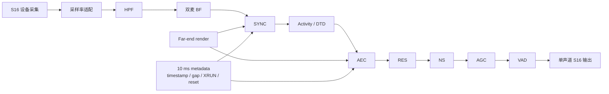
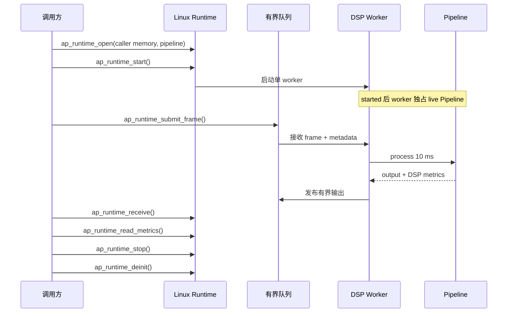
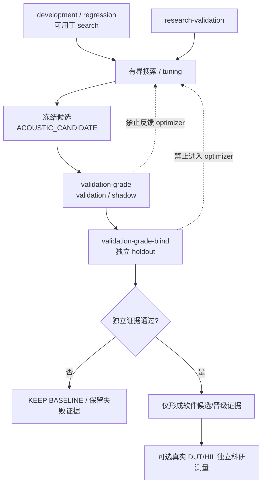
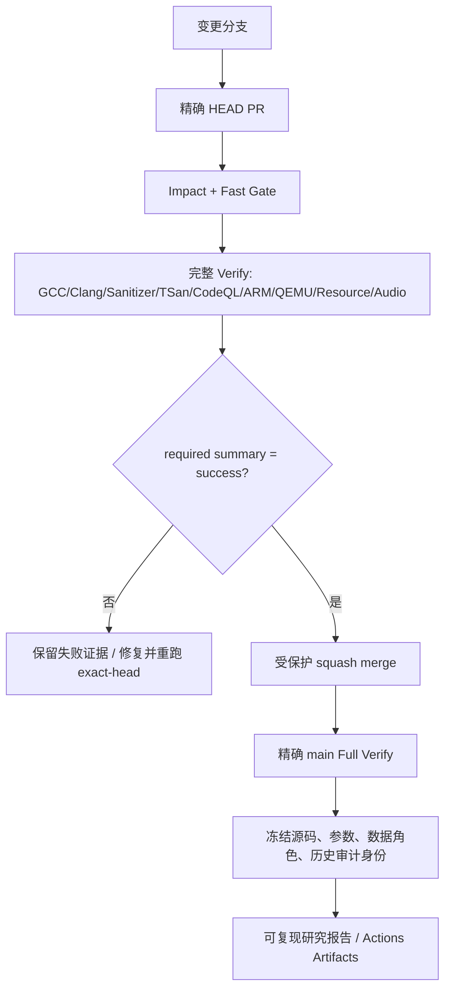
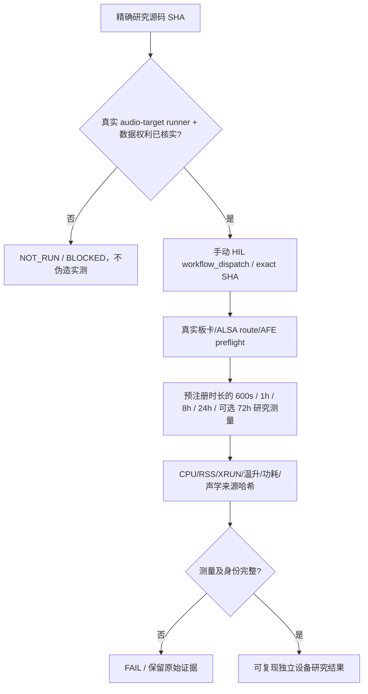
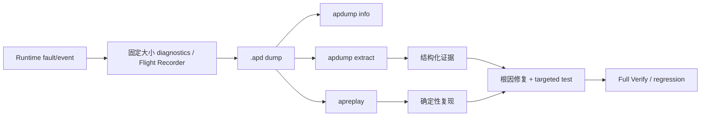
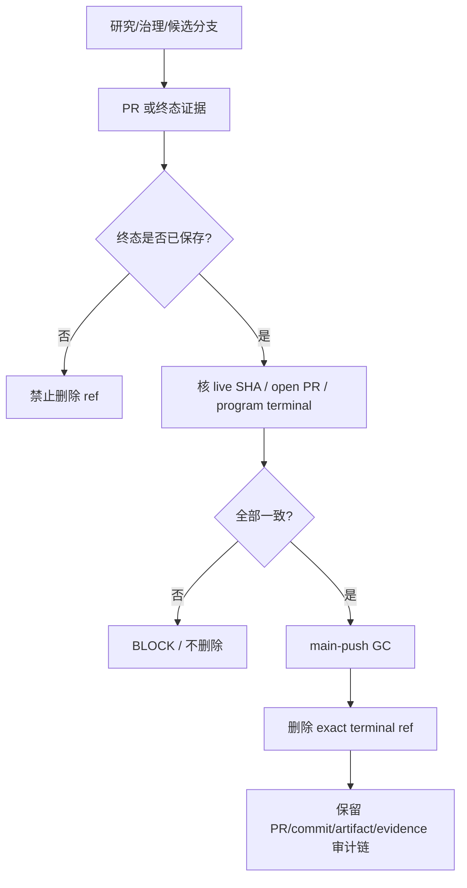

# 关键流程图（中文）

本页把仓库已经存在的机器契约画成可读流程图。流程图**不创建新的权限**；与 workflow、schema 或 `validation/authority.json` 冲突时，以机器契约为准。

## 1. 音频数据流

核心约束：固定 10 ms frame；同步 stage/core 不做 heap、文件/网络 I/O、mutex 或格式化日志；CPU 型号不进入算法依赖。

## 2. Runtime 所有权与线程

控制面不能绕过 worker 直接修改 started 状态下的 Pipeline；ownership/queue/counter 变更必须通过 TSan 契约。

## 3. 数据集自测、调参与晋级权限

关键规则：validation-grade/blind 不能用于挑参数；重复使用同一数据不是新的独立确认；任何搜索都不能自动修改默认算法或将开发集结果冒充独立验证。

## 4. PR → protected main → 研究证据

科研主线只需代码与独立数据门禁，**不得**因为 PR 或 main Verify 成功就自动发布 GitHub Release、商用 SDK 或产品认证结论。历史不可变版本与标签保留原样供审计，不是新实验准入。

## 5. 研究结果 → 可选真机实验

`READY` 只是基础设施状态，不是 HIL、声学或整机性能 PASS。Host/QEMU 与真实板卡测量相互独立。没有固定的产品认证时长门禁，不存在发布后自动 HIL 监听；原有 E001/认证资料是历史记录，见 [研究执行边界](RESEARCH_ONLY_EXECUTION.md)。

## 6. Dump / Replay 故障闭环

Realtime worker 不执行 dump 文件 I/O；dump 可能包含真实人的录音，研究者必须按数据来源的实际许可、访问控制和保留策略实施受限存储与安全删除。

## 7. 分支/证据生命周期（branch lifecycle）

任何 branch GC 都不获得 DSP、真实 HIL、研究结果准入或历史发布资料的修改权限。
