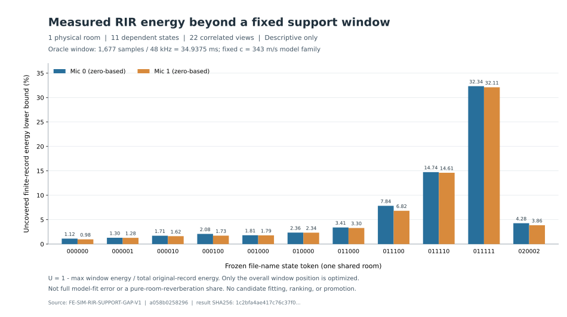

# dEchorate 实测 RIR 有限支撑差距：单次冻结执行与独立复验结果

本报告读取已经封存的 [result.json](result.json)，没有重新运行测量、重新选择窗口长度或增加候选。
执行身份为 **FE-SIM-RIR-SUPPORT-GAP-V1**，公开方法 PR 为
[#973](https://github.com/jiying2007/audio-pipeline/pull/973)。实际测量和独立复验已完成；
科研集成 PR 仍须完成最后 head 的适用 CI、受保护合并及新的 main 核验，不能借用原测量状态代替。

## 发现与解释边界

在固定 c=343 m/s、原 7 路径模型族的保守 **1677 个 48 kHz 样点（约 34.94 ms）** 支撑窗下，
允许 oracle 选择整体时间位置后，22 条相关视图的**未覆盖有限记录能量下界**为：
最小 **0.975639%**、中位 **2.348868%**、最大 **32.336418%**。
这三个数直接来自冻结结果中 `descriptive_uncovered_fraction` 的百分比显示。

该指标是对所声明有限支撑模型族的保守能量覆盖限制，不是已测得的模型全拟合误差，
不是物理混响的纯份额，也不是算法质量提升或衰减量。没有拟合实际七路径幅度；连续区间已经比
七个稀疏路径更宽松。未覆盖能量可混合高阶/扩散响应、换能器响应、测量链、噪声与有限记录效应。
即使覆盖缺口较小，也不能据此证明该模型拟合正确。绝对物理 t0 仍是 **UNKNOWN**。

材料来自 **1 个物理房间、11 个相关墙状态、22 条固定前两麦视图**，不是 11 个独立房间或
22 个独立统计样本。原 canonical loader 材料化并有限性检查 55 条 native RIR，计分仅为冻结的22条。
状态只使用原文件名 token；11 份 SOFA 的 RoomDescription 都误写为同一个020002值，
因此没有逐墙因果推断。RoomTemperature=0 与 RoomVolume=0 占位字段也没有被解释为实测值。

图仅把已保存的22个比例乘100显示，使用标准 Matplotlib；没有重新读取 Data.IR 或计算新声学指标。
图中的通道编号均为0起始。图源码与完整数据分别为 [plot_rir_support_gap.py](figure/plot_rir_support_gap.py)、[plot-data.json](figure/plot-data.json)。

## 完整22行主结果

`C` 为固定长度窗在任意整体位置的最大覆盖比例；`U=1-C` 为相应未覆盖有限记录能量下界。
下列 oracle 区间使用原 48 kHz 记录的样点坐标，右端不含；它不是直达声标注或物理 sample-zero。

| 原文件名状态 | 麦索引（0起始） | C 覆盖比例 % | U 未覆盖下界 % | Oracle 样点区间 |
|---|---:|---:|---:|---|
| 000000 | 0 | 98.876875 | 1.123125 | [181, 1858) |
| 000000 | 1 | 99.024361 | 0.975639 | [175, 1852) |
| 000001 | 0 | 98.703056 | 1.296944 | [182, 1859) |
| 000001 | 1 | 98.717561 | 1.282439 | [177, 1854) |
| 000010 | 0 | 98.288592 | 1.711408 | [181, 1858) |
| 000010 | 1 | 98.378272 | 1.621728 | [176, 1853) |
| 000100 | 0 | 97.915946 | 2.084054 | [183, 1860) |
| 000100 | 1 | 98.271006 | 1.728994 | [177, 1854) |
| 001000 | 0 | 98.191939 | 1.808061 | [175, 1852) |
| 001000 | 1 | 98.212135 | 1.787865 | [176, 1853) |
| 010000 | 0 | 97.643903 | 2.356097 | [178, 1855) |
| 010000 | 1 | 97.658362 | 2.341638 | [176, 1853) |
| 011000 | 0 | 96.593486 | 3.406514 | [180, 1857) |
| 011000 | 1 | 96.699158 | 3.300842 | [177, 1854) |
| 011100 | 0 | 92.158154 | 7.841846 | [183, 1860) |
| 011100 | 1 | 93.176816 | 6.823184 | [176, 1853) |
| 011110 | 0 | 85.264132 | 14.735868 | [183, 1860) |
| 011110 | 1 | 85.390911 | 14.609089 | [178, 1855) |
| 011111 | 0 | 67.663582 | 32.336418 | [183, 1860) |
| 011111 | 1 | 67.885701 | 32.114299 | [179, 1856) |
| 020002 | 0 | 95.723018 | 4.276982 | [179, 1856) |
| 020002 | 1 | 96.137215 | 3.862785 | [177, 1854) |

每条原始48000-sample记录的总能量、decoded float64 SHA、六个固定记录窗口的能量/比例，
以及全部元数据和结果精度均保留于 [result.json](result.json) 与 [scientific-summary.json](scientific-summary.json)。
六窗是原记录坐标上的 [0,5)、[5,20)、[20,50)、[50,100)、[100,200)、[200,1000) ms，
不分别命名为直达、早反射或晚混响。该结果未增设有利数值阈值。

## 真实执行与独立复验

- 冻结源码：`a058b02582962875ac10e6bb42b928c46c405213`，tree `e2b41d4a7f3678efa065dfabc09ea29ebc2c2071`。
- 原12对象总大小19,403,164 B，逐项原大小/SHA匹配；封存方法源码闭包10文件。
- 实际 run：2026-11-27 19:00:08.620673 至19:00:09.821482 UTC（北京时间11月28日），
  exit 0、stderr为空；内部测量计时 **1.077394567 s**，外层进程 **1.200799435 s**。
- 只有一次 run、0自动重试、0产品DSP、0模型拟合/搜参、0候选晋级；90秒预算未放宽。
- 独立 frozen CLI verify：2026-11-27 19:00:31.247662 至19:00:32.086020 UTC，
  exit 0、**0.838363503 s**；原始[独立复验回执](independent-receipt.json)随本页保存；stdout/stderr在完整证据包的 `independent-verify/`。
- 实际宿主 Python 3.12.14 / NumPy2.3.5 / h5py3.15.1 / HDF5 1.14.6；
  实际系统与已加载原生module哈希在sealed结果。没有把Python3.8语法检查写成3.8实际执行。

原 stdout 状态为 `MEASURED_DESCRIPTIVE_RIR_SUPPORT_GAP`；独立复验为
`VERIFIED_DESCRIPTIVE_RIR_SUPPORT_GAP`。共同决定保持
`DESCRIPTIVE_ONLY_NO_PROMOTION_NO_MODEL_FIT`。这是有真实独立波形观测的数据侧模型差距诊断，
不等于物理设备校准完成，也不重开 S003 或旧算法候选。

## 精确证据身份

| 对象 | SHA256 |
|---|---|
| 公开冻结合同 | `7f11a622a856dde9b2e9c8465eb767cb34e1ce6c184e33d52b686fb3a3dbc0dc` |
| 原12对象资格锁 | `fd34472318f8cf47edbbb2e0428a381faca3820864be851ebfb734ec7e53d2c1` |
| result.json | `1c2bfa4ae417c76c37f0b14851b72e541bff447e08129addae0ed67c72ba29c2` |
| sealed manifest.json | `e4d9e7a331c3d6b62e9777bbc7f10abf93d45049ea2a603a2f12c6436346922a` |

原始数据未修改。`sealed/`、`execution/`、`independent-verify/`、`source-recovery/`和
`ATTRIBUTION.zh-CN.md`均指完整证据包内部路径，不是本公开目录内缺失的文件。
包的大小、SHA、内容及数据归属见本目录[README](README.zh-CN.md)和[archive-identity.json](archive-identity.json)。
执行日志与本报告在sealed目录外；没有编辑结果、协议、源码或封存manifest。
