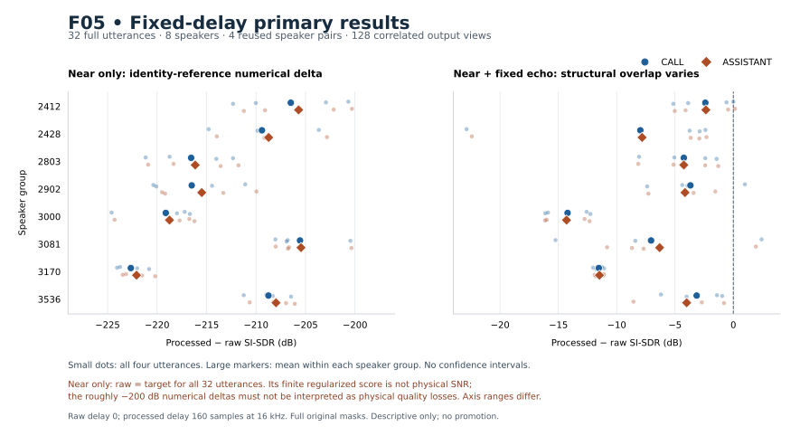

# F05：新八说话人双麦固定验证结果与独立回读

**一次冻结的 128 次处理已经完成，独立原读者重算通过；结论保持 `NO_PROMOTION_DESCRIPTIVE_VALIDATION`。**
在含双讲的整句上，CALL / ASSISTANT 的 8 个说话人均值全部为负，本组固定测试没有显示一致的近端波形保真提升。
本页把实际测量与工程验收分别记录，不以 canonical `pass_rate=1` 替代音质判断。

原 [执行前合同](../F05_DUALMIC_VALIDATION_V1.zh-CN.md)、[来源准备](../F05_SPEECH_SOURCE_20261128.zh-CN.md)
与入口中的“尚未执行”是执行前历史记录；本页追加实际结果，不回写或抹去原记录。
本轮平台审查的逐项落地及后续范围见 [闭环说明](../PLATFORM_IMPLEMENTATION_CLOSURE_20261128.zh-CN.md)。

## 1. 原测量身份

| 项目 | 实际身份 |
| --- | --- |
| 研究 ID | `F05-DUALMIC-RESERVED-VALIDATION-V1` |
| 冻结执行、处理器和原读者源码 | [`637643753166dee42efd325bed76b7fd8e7237c4`](https://github.com/jiying2007/audio-pipeline/commit/637643753166dee42efd325bed76b7fd8e7237c4) |
| 执行 tree | `fd30b3c115120723b58505ee36a1b7475ceb8533` |
| 科学合同 SHA-256 | `f9a32ca63a8ca62ae87d97276033481100de5b953aec0b668dc1526b98f315ce` |
| AP 原 CI | [run 46065975163 / attempt 1](https://github.com/jiying2007/audio-pipeline/actions/runs/46065975163)，job `140731320058`，artifact `15230219751` |
| AP 处理器 SHA-256 | `597059faa3eca090d22a4f0d451bcfd2a0e2acb899511250a9f844b5fbc7b23b` |
| 原 report SHA-256 | `56e74933924a7851ef2d0314c792ccbc3bb372faf7c79ac7dc4cc8e33c067148` |
| 原 2044 文件 payload manifest SHA-256 | `287d33221ae1b81bac623c96f9a6c3b5c6b7ba02d72866c119ac28cc4e5a9166` |
| 原来源归档 SHA-256 | `76f87d090650617fca0cac8f88b9416e0ebf80350acb97b343a85fa903728ab3` |
| 原宿主工程回执 SHA-256 | `a7e644c6dd67ee56ba35ac50787402f4fc8d0dc895d4f97397198a33702df6e4` |

源码 637 之后的 CI 接线或结果发布提交，不是本次测量的新执行源码。科学合同、输入、输出、
默认参数和原评分实现没有据结果调整。CI 的 C/C++ 编译、宿主工程复验、语音测量与独立回读是不同阶段；
不能把 Linux x86_64 的 wall time 当作 SSC305 延迟或硬件资格。

## 2. 完整来源、处理次数与预算

来源是 8 位说话人的 32 条完整 LibriSpeech 原句，共 **5,241,680 samples / 327.605 s**。
四个不相交配对为 `(2412,2428)`、`(2803,2902)`、`(3000,3081)`、`(3170,3536)`。
每位 4 句，近远端角色按合同互换；near-only 与固定 echo 构成 64 个合成双麦输入，分别运行
默认 CALL / ASSISTANT，形成 **128 个相关输出视图**，共 **28,277,760 samples / 1767.36 s**。
后一个时长包含重复视图、声明的前后填充与帧补齐，不是新增独立录音时长。

| 阶段 | 实际结果与耗时 | 冻结预算 / 执行边界 |
| --- | --- | --- |
| 输入 build | 1 次，42.271019 s；外层 42.610982 s | 120 s；0 解码、0 processor |
| 矩阵与封存 | 1 次，399.492621 s；外层 399.804308 s；128 attempted / 128 completed | 600 s；每 processor 30 s；0 重试、0 参数搜索 |
| 处理器 wall time 之和 | 5.255026 s | 仅本宿主执行记录，不等于端到端或设备 deadline |
| 独立原读者回读 | 1 次真正 verifier 调用，386.974969 s；外层审计 386.980155 s | 600 s；0 SDK、0 codec、0 C/C++ 编译 |

矩阵执行时间为北京时间 **2026-11-28 04:52:55–04:59:35**；原件保留 UTC 起止与 exact argv。
输出共有 176,736 个 10 ms 帧。某些 canonical `metrics.frames` 实际记录样本数，不能直接将其当作帧数。
所有 64 个主评分原句 mask 完整保留，不为了统一长度截掉长句尾部，也没有依据 target 搜索主延迟。

本来源角色为 `reserved-validation-visible-scope-separated` / **`NOT_BLIND`**。
输入哈希封存不等于盲测或普遍独立性；同句跨场景、跨 profile 复用以及配对内角色互换仍相关。
128 是处理调用数，不是 128 个独立样本；8 个 speaker 均值也不能自动视作独立同分布样本。
本次无训练、optimizer 选优、参数搜索、候选晋级或历史候选重开。

## 3. 固定延迟主结果

主指标固定 raw = 0、CALL = 160、ASSISTANT = 160 samples，16 kHz 下后两者为 10 ms。
每句先计算 processed − raw 的 SI-SDR 差，再对每位 speaker 的 4 句求均值，最后报告 8 个 speaker 均值的中位数。
它不是所有句子的中位数，也不是“输出中位数减输入中位数”。

| 场景 | Profile | speaker 均值中位 Δ SI-SDR / dB | 逐句正 / 零 / 负 / null | 输出 SI-SDR 中位数 / dB |
| --- | --- | ---: | --- | ---: |
| Near-only | CALL | −212.950600* | 0 / 0 / 32 / 0 | 8.595281 |
| Near-only | ASSISTANT | −212.108885* | 0 / 0 / 32 / 0 | 9.056972 |
| 含双讲的整句 | CALL | −5.648875 | 3 / 0 / 29 / 0 | 3.643559 |
| 含双讲的整句 | ASSISTANT | −5.283438 | 2 / 0 / 30 / 0 | 3.133300 |

\* **Near-only 的 raw 与 target 在全部 32 句上完全相同。** 原评分保留零残差数值正则化后的有限大值，
raw 中位数为 220.908004 dB，范围 211.204272–231.903350 dB。
因此表中的约 −212 dB 差值必须与 identity 标记一起保留，不能解释成真实约 200 dB 的音质损失、
物理信噪比下降或硬件动态范围变化，也不能作为“异常值”删除。

含双讲整句的 raw SI-SDR 中位数为 7.376795 dB。两个 profile 的 **8 个 speaker 均值全部为负**，
但逐句仍分别有 3 个和 2 个正值；不能写成所有句子均劣化。
本测量仅支持该固定来源、配置和指标下的描述性判断，不证明主观听感、ASR/KWS 变化，
也没有把具体因果损失归给某个模块。

图中小点保留全部 128 个逐句差值，大点为 32 个场景/profile/speaker 均值，没有置信区间或显著性声称。
两面板横轴范围不同；左侧 identity 数值差不能按物理损失解释。
[机器摘要](measurement-summary.json)保留全部 64 个主评分行、128 个 canonical case、
完整逐 speaker 数值、正负/null 以及原 summary，没有用图或均值取代原件。

封包保留原 Matplotlib SVG（SHA `4398173eb0215b5b8208d3f0e69df012383eb36fd36709aa452bb222f05e6d17`）。
为满足仓库既有空白检查，公开 SVG 只去除 1514 字节行末空白，SHA 为
`78ad295820a94eb62218d2e74580b07576e51b69c152d4aef92ecf2ea1e939bf`；
XML 节点、属性、文字和 path 数值 token 逐项相同。原封包、数据和图的几何没有改写。

## 4. 结构交集和辅助结果的准确含义

固定 FIR echo 的支撑与近端原句区间交集如下。双麦分数延迟改变支撑边界，因此分列两麦。

| 麦克风 | 最小 / 中位 / 最大交集占比 | 完整 / 部分 / 零交集原句数 |
| --- | --- | --- |
| mic0 | 8.417888% / 69.896915% / 100% | 14 / 18 / 0 |
| mic1 | 8.418828% / 69.898701% / 100% | 14 / 18 / 0 |

这是 **FIR 结构支撑交集**，包括原录音停顿和低能量部分，不是 VAD 真值、全程双讲活动率或真实房间混响覆盖率。
本测试使用近端 0°、echo 60°、35 mm 间距、0.25 来源增益和冻结稀疏 echo taps，属于合成传播。
这些参数不是对真实阵列的几何或声学校准。

辅助 canonical 指标保留旧定义：目标相关对齐 ±3 ms，render/interference 相关诊断 ±100 ms。
实际辅助输出对齐为 116 例 160 samples、12 例 159 samples；**主指标仍全部使用固定 160**。
辅助近端 SI-SDR improvement 中位数为 −3.621556 dB，P10 为 −10.885794 dB，适用 64 个含双讲输出、混合两个 profile。
这不是全部 128 个输出的固定延迟主统计；near-only identity 仍完整保存在逐例和主结果中。

输出对 render 的相关系数降低中位数为 0.268413，P10 为 0.079175，单位是相关系数差，不是 dB 或 ERLE。
输入与输出采样削波比例均为 0，`pass_rate=1.0` 只表示没有违反已声明检查项，不能转写为整体音质 PASS。
ERLE、VAD F1/recall、噪声专属衰减等未测或不适用项继续保留 `null`，不能补 0 或标为通过。

## 5. 独立回读、失败保留和读者范围

[独立回读记录](independent-readback.json)保留原 verifier 输出及外层效果审计摘要。
它重新核对冻结 Git/plan/输入、重建渲染、校验原输出/trace/命令，并重算原数学指标；
报告和原 manifest 的 SHA 在回读前后不变。它是**分离进程中的同一冻结实现复验**，不是独立数学实现的交叉验证。

外层实际记录 1259 个只读 Git、3 个只读 ldd 子进程，以及一次精确 CI helper 动态载入；
SDK、codec 和 C/C++ compiler 调用均为 0。helper SHA 为
`77499af684aab889115e3742e82aa8c1da2ad50194c2c4a1fb5915a9866609fa`。
原 verifier 的“两次数学运行时观察”指评分前后；外层“三次 ldd”还包含包准入观察，两者口径不同。
这不是零子进程或纯 Python 运行，也不是第二轮音频处理。

此前外层 wrapper 预检误用了 loader 属性名 `_NATIVE`，在调用真正 verifier 前约 0.055 s 失败。
原脚本、空 stdout、完整 stderr 和失败回执均保留；仅修正外层审计引用为实际 `_NATIVE_STATE`。
冻结 verifier 和科学方法未改，真正 verifier 仅执行一次，没有悄悄重跑测量。
原执行者 handoff 生成于独立回读之前，其 pending 字段作为历史原件保留，本页另行追加完成状态。

完整证据包保存原 337,926,286 B 来源归档、完整输入/输出/日志、成功 AP 原 ZIP 与 inner tar、工程回执、
冻结源码的最小 Git 增量、独立回读及预检失败、图的数据派生程序和外层逐文件 SHA。
包名 `audio-pipeline-f05-dualmic-evidence-20261128.tar.gz`，实际 **527,893,643 B**，SHA-256 为
`7b7b33bfcab9ea3715a11b8d5d420ef519e8641902d36a0a03cd851ac69f142f`。
3720 个 regular 成员（3719 payload 加外层 manifest），无 symlink/hardlink；成员集合、大小、SHA 与权限逐项回读通过。
外层 manifest SHA 为 `2928c9885b88309a69b145e12ffad8af83e170b9e5ca9cab77ce8b42f06c8c0d`。
保存定位与精确 PR/main 工程状态记于 [#968 的最终闭环回执](https://github.com/jiying2007/audio-pipeline/issues/968)。

复验须使用原 637 checkout、原 F05 合同与包内 helper。Git 增量以公开 4eec 及完整祖先对象为前提，
不包含整个 Git 历史、OS、Python/Git/ldd 或全部系统库；它不是无条件全环境离线镜像。
新宿主不兼容应记录失败，不允许自行编译替换 helper、换评分实现或重跑矩阵。

## 6. 完成与未执行范围

本轮完成来源审计、完整来源准备、固定双麦 CALL/ASSISTANT 整链描述性测量、负结果保留和独立回读。
没有真人听评、ASR/KWS、真实阵列/独立房间、SSC305 物理执行、新模型/权重、训练或优化选优。
专用 harness 不暴露优化路径，但现有通用 authority/optimizer 尚非全平台不可绕过的数据角色隔离，不能把本次合同当作通用访问控制证明。

下一项 F07 问题是在查看本次 reserved 结果之前，依据已披露 AEC3 六例 development 与 RIR 诊断选定的
linear tap / final 信息保留比较；本次结果不用于改变它的窗口、指标、参数或结构。
该后续内部研究尚未执行，准确状态见 [平台闭环说明](../PLATFORM_IMPLEMENTATION_CLOSURE_20261128.zh-CN.md)。
